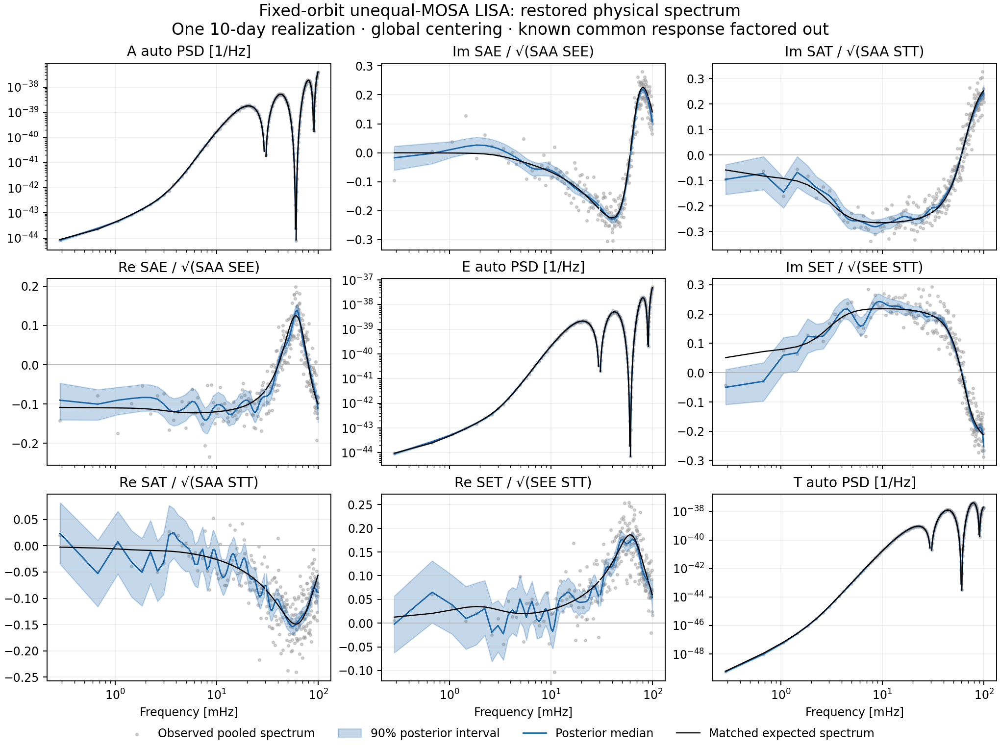

# Saved stationary baseline — 29 October 2026

The commands in the parent README generated a fresh paired ten-day record and
fit the unequal-MOSA AET data with four sequential NUTS chains, each with 1,000
warmup and 1,000 retained draws. Both data and fit seeds were 20261029. The fit
used 20/50/20 delta/real-theta/imaginary-theta knots, target acceptance 0.95,
maximum depth 10, and the merged library revision
`efd0c7d8abe6fbb090ed8eb1a83da3481b623a8f` with no tracked source changes.

| Cholesky row | Divergences | Maximum R-hat | Minimum bulk ESS | Minimum tail ESS | Minimum BFMI |
| --- | ---: | ---: | ---: | ---: | ---: |
| 0 | 0 | 1.00227 | 4723 | 2691 | 0.985 |
| 1 | 0 | 1.00317 | 3581 | 2661 | 0.912 |
| 2 | 0 | 1.00252 | 3522 | 2960 | 1.006 |

No chain hit the depth limit. All parameter diagnostics were finite. Thresholds
use unrounded numbers: R-hat below 1.01, bulk and tail ESS at least 400, BFMI at
least 0.3, zero divergences and zero depth-limit hits. These checks passed for
this realization; they do not establish interval calibration.

The symmetric equal-arm covariance formula agrees with the generator to
8.42e-13. Independent saved-record FFT whitening errors are below 1.76% in the
0.1–20 mHz validation band. Nine direct Fourier-matrix checks of the reference
expectation agree within 8.69e-16 relative error.

All 4,000 restored posterior matrix draws at all 251 retained frequencies are
finite and positive definite. The smallest eigenvalue after diagonal normalization
is 0.5993. Physical restoration agrees exactly with residual draws times Gbar;
recomputed marginal quantiles agree within 2.29e-16 relative error. Coherence is
unchanged. Median fit/reference auto-spectrum ratios across frequency are
0.9990, 1.0054 and 0.9948 for A, E and T. At the first pooled bin the respective
ratios are 0.9293, 0.9477 and 0.9208, so the good overall agreement does not imply
negligible error everywhere.

Diagonal panels show physical auto PSDs. Off-diagonal panels show the real and
imaginary parts of upper-triangle CSDs divided by the square root of the matched
reference auto-spectrum product. This reference normalization is for presentation
only. Gray points are observed pooled spectra; black is the matched finite-record
expected spectrum; blue is the posterior median with marginal 90% intervals.
Intervals and across-frequency containment fractions describe one realization,
not repeated-noise coverage. The 0.1–1 mHz band contains only two coarse bins.

Files:

- `generation_manifest.json`: physical model, exact fixed-orbit checks, versions,
  generator hash and generation-time checks.
- `generation_validation.json`: independent checks of the saved HDF5 records.
- `provenance.json`: configuration, input hash, library revision and source hashes.
- `summary.json`: sampler diagnostics recomputed from the saved posterior.
- `recovery.json`: mean-reference recovery and all-draw restoration checks.
- `spectral_recovery.png` / `.pdf`: the figure above.

Generation used NumPy 2.4.6, PyTDI 2.2.1 and lisaorbits 3.0.3; inference versions
are recorded in provenance. The installed package's distribution-version label
was stale in an editable environment; the clean source revision and source
hashes identify the actual library code. Dependencies for the documented
single-environment installation were successfully resolved without conflicts.

The sampling runner's original hash is retained in provenance. Its report
formatting was corrected after sampling to handle numeric ArviZ summaries and
use unrounded diagnostic values; diagnostics and figures were recomputed from
the saved draws with the final source hashes recorded in summary/recovery. The
sampling algorithm, configuration, data and posterior were unchanged. Fit wall
time was not preserved before that report failure, so it is recorded as null.

Raw HDF5 data and posterior arrays are generated locally and are not committed.
This is a stationary baseline, not a validation of the time-varying PR.
